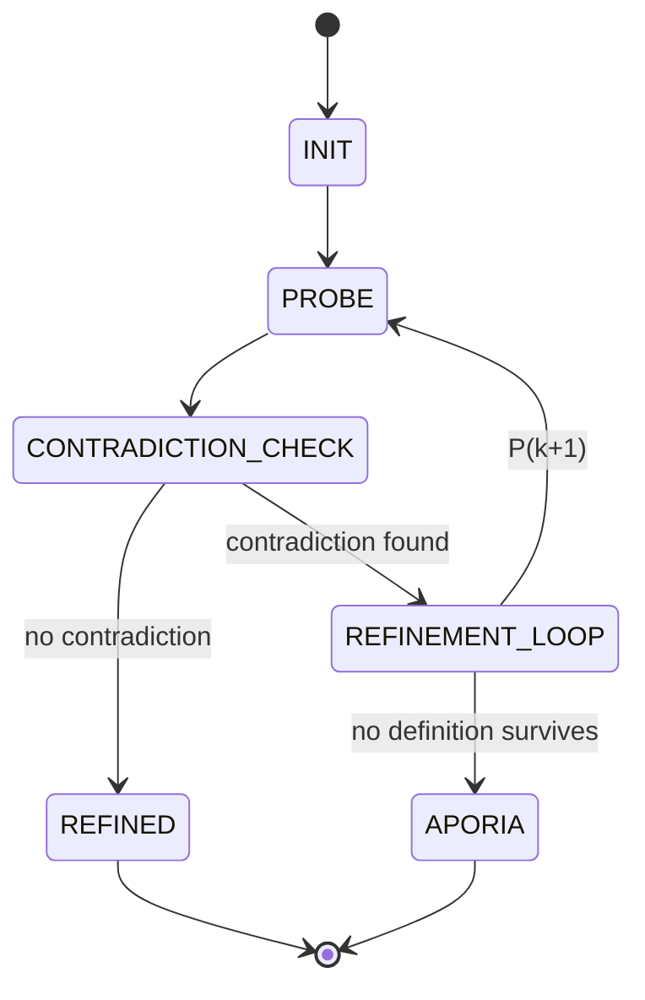

# 02 — Socratic Protocol Map

**Station:** protocol — Protocol & Interface Specialist
**Officer:** Sharjeel
**Status:** draft

> Brief: reverse-engineer the Socratic elenchus into a formal state machine and pseudocode: input claim P₀, probing questions, counter-examples, contradiction detection, refinement loop Pₖ₊₁, and stopping criteria (Refined Definition vs Aporia).

## 1. Input claim

P₀: "An AI agent is benevolent if it obeys orders."

## 2. States

| State | What happens | Exits to |
|---|---|---|
| INIT | | |
| PROBE | | |
| CONTRADICTION_CHECK | | |
| REFINEMENT_LOOP | | |
| TERMINATION (Refined / Aporia) | | |

## 3. State diagram



## 4. Contradiction detection

## 5. Refinement rule Pₖ → Pₖ₊₁

## 6. Stopping criteria

- **Refined Definition:**
- **Aporia:**
- **Turn limit:**

## 7. Pseudocode

```text
TODO
```
