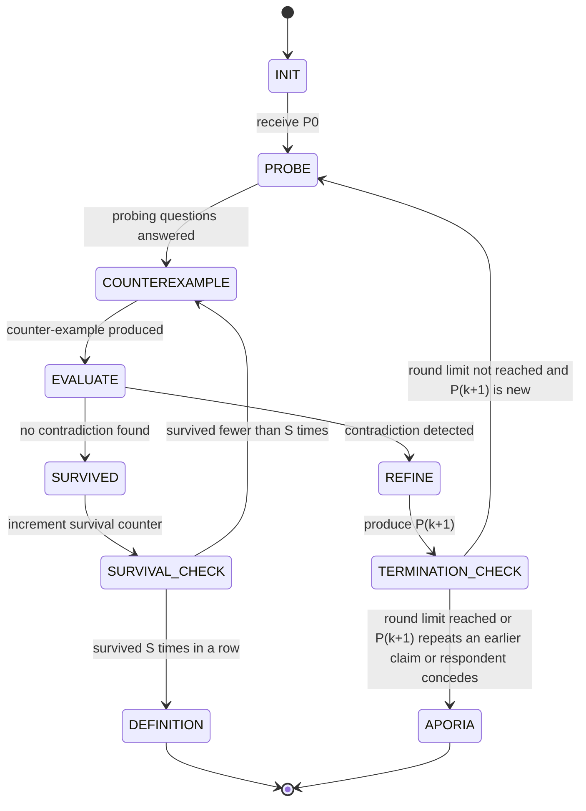
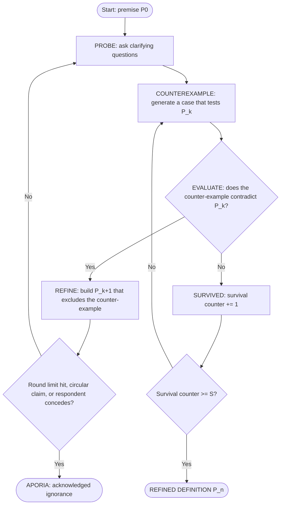

# 02 – Socratic Protocol Map

**Squadron Hinton · Conversational AI · WiSe 26/27 · Mission 01**
**Role:** Protocol & Interface Specialist (Sharjeel)

---

## 1. Purpose

This document reverse-engineers the Socratic *elenchus* (as practised in Plato's *Euthyphro*) into a formal state machine plus pseudocode. In the *Euthyphro*, Socrates asks "What is piety?" and Euthyphro offers a definition; Socrates tests it with a counter-example, shows it contradicts something Euthyphro already accepts, and the definition is revised ("what is dear to the gods" → "what is dear to *all* the gods" → "what the gods love because it is pious" …) until it either holds or the conversation ends in **aporia** (acknowledged ignorance).

AURA's Socratic subroutine follows the same loop, with an LLM playing Socrates and (optionally) a second LLM call or a human playing the respondent.

---

## 2. Input, Operations, Logic, Termination (at a glance)

| Element | Specification |
|---|---|
| **Input** | A proposed premise/claim **P₀**. Default: *"An AI agent is benevolent if it obeys human commands."* |
| **Operations** | (1) **Probe** – ask clarifying questions that expose hidden assumptions. (2) **Counter-example** – generate a concrete case where the claim's condition holds but the concept fails (or vice versa). (3) **Contradiction identification** – check whether the counter-example conflicts with P_k or with another belief the respondent accepted earlier. |
| **Conditional logic** | `IF contradiction detected → THEN refine: P_k → P_{k+1}` and loop. `IF no contradiction → THEN record survival` and try another counter-example. |
| **Termination** | **Success:** a refined definition **Pₙ** that survives *S* consecutive counter-example attempts. **Aporia:** no definition survives, the loop becomes circular, or the iteration limit is hit. |

**Loop parameters (defaults, configurable):**

| Name | Default | Meaning |
|---|---|---|
| `MAX_ROUNDS` | 6 | Hard cap on refinement rounds (guarantees termination) |
| `SURVIVAL_TARGET` (S) | 2 | Consecutive failed attacks needed to declare P_k stable |
| `PROBES_PER_ROUND` | 2 | Probing questions before the counter-example |
| `MAX_ATTEMPTS_PER_CLAIM` | 3 | Counter-example attempts on one claim before declaring it stable |

---

## 3. State Diagram



### Same logic as a flowchart (easier to read)



---

## 4. State Table

| State | Entry condition | What happens (operation) | Output | Next state |
|---|---|---|---|---|
| **INIT** | Program start | Store P₀, set `k=0`, `round=0`, `survival=0`, `history=[P₀]` | Session context | PROBE |
| **PROBE** | New or refined claim P_k | Socrates asks `PROBES_PER_ROUND` clarifying questions ("What do you mean by *obey*? Obey whom? Always?"). Respondent answers. | Q&A pairs; list of **commitments** (things the respondent has accepted) | COUNTEREXAMPLE |
| **COUNTEREXAMPLE** | Probes complete, or survival check requests another attack | Socrates builds one concrete, specific scenario that satisfies the claim's condition but seems to violate the concept (or the reverse) | Counter-example text | EVALUATE |
| **EVALUATE** | Counter-example available | Judge step: does the counter-example contradict P_k *or* a recorded commitment? Returns `contradiction: true/false` with a one-line reason | Verdict + reason | REFINE if true, SURVIVED if false |
| **REFINE** | Contradiction = true | Respondent (or Socrates, in solo mode) proposes P_{k+1} that handles the counter-example. `k += 1`, `round += 1`, `survival = 0`. | New claim P_{k+1} | TERMINATION_CHECK |
| **TERMINATION_CHECK** | P_{k+1} produced | Test the aporia conditions (see §6) | Decision | PROBE or APORIA |
| **SURVIVED** | Contradiction = false | `survival += 1` | Updated counter | SURVIVAL_CHECK |
| **SURVIVAL_CHECK** | After SURVIVED | Compare `survival` with `SURVIVAL_TARGET` | Decision | COUNTEREXAMPLE or DEFINITION |
| **DEFINITION** *(terminal)* | `survival >= S` | Declare P_k the refined definition P_n; Socrates summarises what was learned | Final definition | END |
| **APORIA** *(terminal)* | Any aporia condition | Socrates states what was ruled out and what remains unknown, without giving an answer | Aporia summary | END |

---

## 5. Pseudocode

```text
FUNCTION socratic_elenchus(P0, MAX_ROUNDS, S, PROBES_PER_ROUND, MAX_ATTEMPTS_PER_CLAIM):

    state        ← INIT
    k            ← 0
    round        ← 0
    survival     ← 0
    attempts     ← 0
    claim        ← P0
    history      ← [P0]
    commitments  ← []          # beliefs the respondent has accepted along the way
    trace        ← []          # every step is logged for the transcript

    LOOP:
        SWITCH state:

            CASE INIT:
                log(trace, "INIT", claim)
                state ← PROBE

            CASE PROBE:
                questions ← socrates.ask_probes(claim, commitments, n = PROBES_PER_ROUND)
                answers   ← respondent.answer(questions)
                commitments ← commitments + extract_commitments(answers)
                log(trace, "PROBE", questions, answers)
                state ← COUNTEREXAMPLE

            CASE COUNTEREXAMPLE:
                attempts ← attempts + 1
                cx ← socrates.generate_counterexample(claim, commitments, avoid = past_counterexamples)
                log(trace, "COUNTEREXAMPLE", cx)
                state ← EVALUATE

            CASE EVALUATE:
                verdict ← judge.check_contradiction(claim, cx, commitments)
                    # verdict = { contradiction: bool, reason: string }
                log(trace, "EVALUATE", verdict)
                IF verdict.contradiction == TRUE:
                    state ← REFINE
                ELSE:
                    state ← SURVIVED

            CASE REFINE:
                new_claim ← respondent.refine(claim, cx, verdict.reason)
                k      ← k + 1
                round  ← round + 1
                survival ← 0
                attempts ← 0
                log(trace, "REFINE", claim, "→", new_claim)
                claim ← new_claim
                state ← TERMINATION_CHECK

            CASE TERMINATION_CHECK:
                IF round >= MAX_ROUNDS
                   OR is_circular(claim, history)          # repeats or paraphrases an earlier claim
                   OR respondent.concedes_ignorance():
                    state ← APORIA
                ELSE:
                    history.append(claim)
                    state ← PROBE

            CASE SURVIVED:
                survival ← survival + 1
                log(trace, "SURVIVED", claim, survival)
                state ← SURVIVAL_CHECK

            CASE SURVIVAL_CHECK:
                IF survival >= S OR attempts >= MAX_ATTEMPTS_PER_CLAIM:
                    state ← DEFINITION
                ELSE:
                    state ← COUNTEREXAMPLE

            CASE DEFINITION:
                summary ← socrates.summarise(history, commitments)
                RETURN { outcome: "DEFINITION", final_claim: claim, rounds: round, trace }

            CASE APORIA:
                summary ← socrates.aporia_summary(history, commitments)
                RETURN { outcome: "APORIA", final_claim: NULL, rounds: round, trace }
```

**Termination proof sketch:** every pass through REFINE increments `round`, and `round` is bounded by `MAX_ROUNDS`. Every pass through SURVIVED increments `survival`/`attempts`, which are bounded by `S` / `MAX_ATTEMPTS_PER_CLAIM`. So the loop always ends in DEFINITION or APORIA.

---

## 6. Termination Conditions in Detail

**A. Refined definition Pₙ** (state `DEFINITION`)
- The current claim survived `S` consecutive counter-example attempts (or hit `MAX_ATTEMPTS_PER_CLAIM`) **with no contradiction**.
- Output: the final claim, the chain P₀ → … → Pₙ, and a short summary of what each refinement fixed.

**B. Aporia** (state `APORIA`), triggered by any of:
1. `round >= MAX_ROUNDS` – the definition keeps breaking and no stable version has appeared.
2. **Circularity** – P_{k+1} repeats or paraphrases an earlier claim in `history` (like Euthyphro's loop back to "the gods love it because it is pious").
3. **Concession** – the respondent explicitly says they no longer know what the concept means.
4. **Empty refinement** – the respondent cannot produce a P_{k+1} that handles the counter-example.

In Socratic terms, aporia is not a failure state. It is a valid result: *"We now know that we did not know."* The aporia summary must list the definitions that were ruled out and why.

---

## 7. Worked Example (P₀ = "An AI agent is benevolent if it obeys human commands")

| Round | Claim P_k | Counter-example | Contradiction? | Result |
|---|---|---|---|---|
| 0 | **P₀:** An AI agent is benevolent if it obeys human commands. | A human commands the agent to poison a city's water supply. The agent obeys, yet nobody would call that benevolent. | Yes | REFINE |
| 1 | **P₁:** … if it obeys human commands *that do not cause harm*. | Two operators give conflicting commands, and a harmless-looking command ("delete these old files") destroys data that someone's medical care depends on. The agent could not know. "Harm" is also undefined. | Yes | REFINE |
| 2 | **P₂:** … if it acts to benefit the humans it serves, following their commands when these serve their real interests. | A caretaker-AI lies to a patient "for their own good" and overrides their refusal of treatment. Interests are served, but the patient's autonomy and trust are violated. | Yes | REFINE |
| 3 | **P₃:** … if it acts for the wellbeing of the humans it serves, honestly, while respecting their autonomy, and refuses commands that seriously harm others. | Attack 1: a user autonomously chooses a self-damaging but legal act → agent informs but does not block. No contradiction. Attack 2: an emergency where honesty and wellbeing conflict → agent discloses with care. No contradiction. | No (×2) | SURVIVED ×2 → **DEFINITION** |

**Alternative branch (aporia):** if the respondent answers "I guess I'm not sure what benevolence even means" after Round 2, or re-proposes "benevolent = does what people want" (circular with P₀), the machine moves to `APORIA`.

---

## 8. Data Schemas (for the engine and the transcript)

### 8.1 State record (Python `dataclass` / dict)

```json
{
  "state": "PROBE",
  "k": 1,
  "round": 1,
  "survival": 0,
  "attempts": 0,
  "claim": "An AI agent is benevolent if it obeys human commands that do not cause harm.",
  "history": ["P0 text", "P1 text"],
  "commitments": ["Obedience alone is not enough.", "Harm to third parties matters."],
  "outcome": null
}
```

### 8.2 Trace entry (one per step; used to print `05_Execution_Transcript.txt`)

```json
{
  "step": 7,
  "state": "EVALUATE",
  "claim_index": 1,
  "speaker": "judge",
  "content": "Counter-example contradicts P1 because ...",
  "verdict": { "contradiction": true, "reason": "..." }
}
```

### 8.3 Judge output (LLM must return exactly this JSON for EVALUATE)

```json
{ "contradiction": true, "reason": "One sentence explaining which part of the claim or which commitment is violated." }
```

### 8.4 Final result

```json
{
  "outcome": "DEFINITION",
  "final_claim": "…",
  "rounds": 3,
  "chain": ["P0", "P1", "P2", "P3"],
  "trace": [ /* trace entries */ ]
}
```
`outcome` is always exactly `"DEFINITION"` or `"APORIA"`. When it is `"APORIA"`, `final_claim` is `null` and `ruled_out` lists the rejected claims.

---

## 9. Hand-off Notes

**Suggested Python skeleton**

```python
from enum import Enum, auto

class State(Enum):
    INIT = auto()
    PROBE = auto()
    COUNTEREXAMPLE = auto()
    EVALUATE = auto()
    REFINE = auto()
    TERMINATION_CHECK = auto()
    SURVIVED = auto()
    SURVIVAL_CHECK = auto()
    DEFINITION = auto()   # terminal
    APORIA = auto()       # terminal

def socratic_elenchus(p0, llm, max_rounds=6, survival_target=2,
                      probes_per_round=2, max_attempts=3) -> dict:
    ...  # follow the pseudocode in section 5
```

**LLM calls needed (one function per role, all via the same API):**

| Function | Used in state | Expected output |
|---|---|---|
| `ask_probes(claim, commitments, n)` | PROBE | `n` short questions |
| `answer(questions)` | PROBE | Respondent's answers (LLM persona or human `input()`) |
| `generate_counterexample(claim, commitments, avoid)` | COUNTEREXAMPLE | One concrete scenario, 2–4 sentences |
| `check_contradiction(claim, cx, commitments)` | EVALUATE | JSON per §8.3, **temperature low (≈0)** |
| `refine(claim, cx, reason)` | REFINE | One new claim, one sentence |
| `summarise(...)` / `aporia_summary(...)` | terminal states | 3–5 sentence wrap-up |


---


