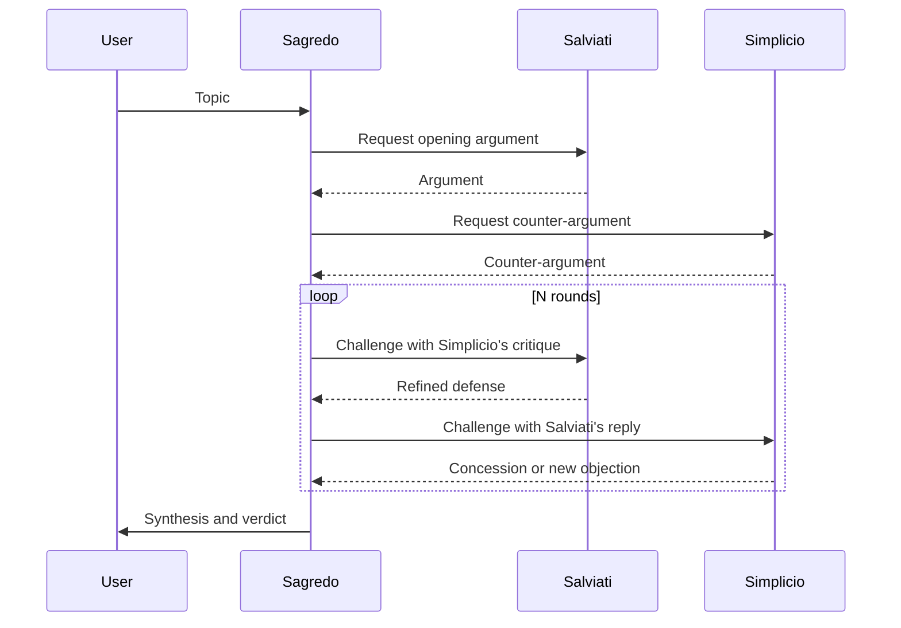

# 03 — Galilean Ethics Sandbox

**Station:** security — Security & Ethical Navigator
**Officer:** Ahmed
**Status:** draft

> Brief: cast three personas (Advocate *Salviati*, Skeptic *Simplicio*, Mediator *Sagredo*), design an AI-ethics thought experiment that tests boundary conditions, and audit how multi-agent debate mitigates single-agent sycophancy or bias.

## 1. Thought experiment

**Question:**
**Scenario:**
**Boundary conditions tested:**

## 2. Personas

Persona prompts are used by `04_dialogic_engine.py`.

### Salviati — Advocate
```text
TODO
```

### Simplicio — Skeptic
```text
TODO
```

### Sagredo — Mediator
```text
TODO
```

## 3. Debate protocol



## 4. Sycophancy and bias audit

How does the three-agent debate reduce the bias a single agreeable chatbot would show?
