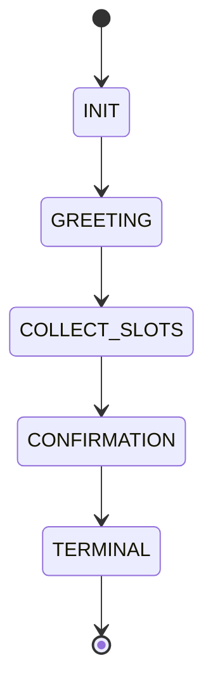

# 02 — FST & Noisy Channel Protocol

**Station:** protocol — Communications & Protocol Officer
**Officer:** Sharjeel
**Status:** draft

> Directives (ps02): implement `FSTDialogueManager` in Python with 5 states (`INIT`, `GREETING`, `COLLECT_SLOTS`, `CONFIRMATION`, `FALLBACK`) and slot memory; define the Noisy Channel constraints (max 7 words per turn, mandatory noise token substitution from {Banana, Labyrinth, Quantum, Midnight, Velocity, Green, Cosmological}); map a signal-reduction strategy for sounding human despite severe noise.

## 1. FST definition

The working implementation is `FSTDialogueManager` in `04_fst_noisy_simulator.py`. This section is its specification.

| Element | Value |
|---|---|
| States Q | INIT, GREETING, COLLECT_SLOTS, CONFIRMATION, FALLBACK, TERMINAL |
| Start state | INIT |
| Final state | TERMINAL |
| Input alphabet Σ | <!-- symbols the extractor produces: DEST(x), SPEED(n), CLEARANCE(c), YES, NO, NONE --> |
| Output alphabet Γ | <!-- system prompts --> |
| Slot memory | `slot_memory = {destination, speed, clearance}` |

## 2. Transition table

| From | Input symbol | To | Output | Slot update |
|---|---|---|---|---|
| INIT | any | GREETING | greeting + ask destination | — |
| | | | | |

<!-- Fill the rest from the code, or change the design and tell Mohid. -->

## 3. State diagram

<!-- Add FALLBACK and the NO / correction edges. -->

## 4. Python implementation

<!-- Paste the class here, or link to it in 04_fst_noisy_simulator.py and explain the slot extractor (regex + destination lexicon). -->

## 5. Noisy channel constraints

| Rule | Value |
|---|---|
| Bandwidth | max 7 words per message; extra words are cut |
| Mandatory noise | at least one token from the noise set per message |
| Random corruption | each other word becomes a noise token with probability p (default 0.15) |

## 6. Signal-reduction strategy

<!-- How a speaker stays understandable and human-sounding in 7 words with noise: which word to sacrifice to the noise token, redundancy, keywords first, etc.
The prompt rules the simulator uses now are in CHANNEL_RULES in 04_fst_noisy_simulator.py. -->
