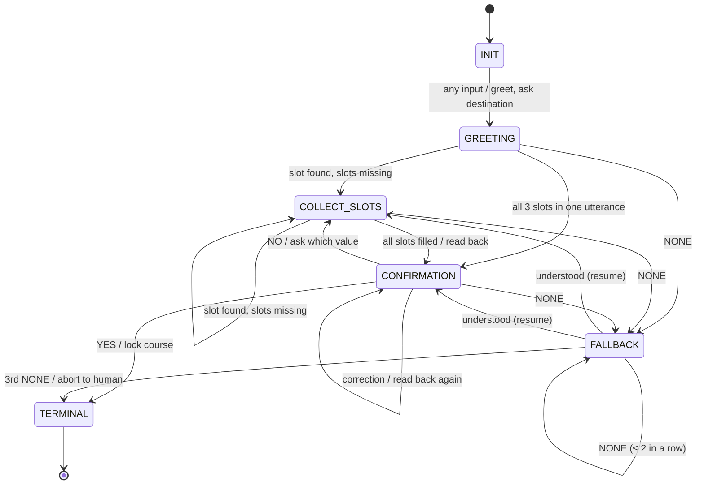

# 02 — FST & Noisy Channel Protocol

**Station:** protocol — Communications & Protocol Officer
**Officer:** Sharjeel
**Status:** final draft

> Directives (ps02): implement `FSTDialogueManager` in Python with 5 states (`INIT`, `GREETING`, `COLLECT_SLOTS`, `CONFIRMATION`, `FALLBACK`) and slot memory; define the Noisy Channel constraints (max 7 words per turn, mandatory noise token substitution from {Banana, Labyrinth, Quantum, Midnight, Velocity, Green, Cosmological}); map a signal-reduction strategy for sounding human despite severe noise.

## 1. Why an FST

When noise makes neural inference unreliable, AURA falls back to a deterministic dialogue core. A finite state transducer reads an input symbol, moves to exactly one next state and emits exactly one output. Its behaviour can be listed in a table and checked by hand: no sampling, no learning, no surprises. The price is brittleness: anything the designers did not foresee is either misread or rejected (see `03_Entropy_Hazard_Audit.md`).

The task is a slot-filling dialogue: plot a course by collecting a **destination**, a **warp speed** and a **security clearance**, then confirming them.

## 2. Formal definition

The dialogue manager is a **Mealy finite state transducer** M = ⟨Q, Σ, Γ, δ, ω, q₀, F⟩. δ: Q × Σ → Q picks the next state, and ω: Q × Σ → Γ picks the output for the same transition. In a Mealy machine the output depends on the state *and* the input, which is what lets AURA's reply read back the slot that was just filled.

| Element | Value |
|---|---|
| States Q | `INIT`, `GREETING`, `COLLECT_SLOTS`, `CONFIRMATION`, `FALLBACK`, `TERMINAL` |
| Start state q₀ | `INIT` |
| Final states F | `TERMINAL` (course locked, or aborted to a human officer) |
| Input alphabet Σ | symbols produced by the extractor from an utterance: `DEST(x)`, `SPEED(n)`, `CLEAR(c)`, `YES`, `NO`, `NONE` (nothing recognised). One utterance may yield several slot symbols at once. |
| Output alphabet Γ | fixed system prompts: greeting, ask-slot, read-back, confirm, reprompt, abort |
| Transition function δ | the *To* column of the table in §3 |
| Output function ω | the *Output* column of the table in §3 |
| Slot memory | `slot_memory = {}` filled with `destination`, `speed`, `clearance` |
| Counters | `fallbacks` (consecutive misses, max 2), `resume_state` (state FALLBACK returns to) |

The five required states are INIT, GREETING, COLLECT_SLOTS, CONFIRMATION and FALLBACK. TERMINAL is the accepting state that ends the run.

### Symbol extractor (utterance → Σ)

| Symbol | Rule |
|---|---|
| `DEST(x)` | first entry of a fixed lexicon found as a whole word: Alpha Centauri, Proxima Centauri, Sirius, Pleiades, Betelgeuse, Crab Pulsar, Eta Carinae, Vega, Tau Ceti, Sol, Earth |
| `SPEED(n)` | `WARP n` or `SPEED n` with n in 1–9; a bare digit only while the FST is asking for speed |
| `CLEAR(c)` | first hyphenated code containing a digit, e.g. `ORION-7`, `CLEARANCE-ALPHA-9` → `ALPHA-9` |
| `YES` / `NO` | any word from {yes, yeah, yep, affirmative, confirm, correct, sure, engage} / {no, nope, negative, wrong, cancel, abort}; NO wins if both appear |
| `NONE` | none of the above |

## 3. Transition table (δ and ω)

| From | Input | To | Output | Slot update |
|---|---|---|---|---|
| INIT | any | GREETING | "AURA FST online… What is your destination?" | — |
| GREETING / COLLECT_SLOTS | ≥1 slot symbol, slots still missing | COLLECT_SLOTS | "Recorded …" + ask next missing slot | merge found slots |
| GREETING / COLLECT_SLOTS | ≥1 slot symbol, all 3 slots filled | CONFIRMATION | read-back: "Confirm course to X at warp N, clearance C? (YES/NO)" | merge found slots |
| GREETING / COLLECT_SLOTS | `NONE` | FALLBACK | "Input not understood." + ask missing slot | — |
| CONFIRMATION | `YES` and no slot symbol | TERMINAL | "Course confirmed and locked." | — |
| CONFIRMATION | slot symbol (a correction, with or without NO) | CONFIRMATION | new read-back | overwrite corrected slot |
| CONFIRMATION | `NO` alone | COLLECT_SLOTS | "Which value is wrong?" | — |
| CONFIRMATION | `NONE` | FALLBACK | "Please answer YES or NO." | — |
| FALLBACK | input the resume state accepts | as that state would go | as that state would answer | as that state would update; `fallbacks` reset to 0 |
| FALLBACK | `NONE`, fallbacks ≤ 2 | FALLBACK | reprompt again | — |
| FALLBACK | third `NONE` in a row | TERMINAL | "Handing over to a human officer. FST execution aborted." | — |
| TERMINAL | any | TERMINAL | "FST execution complete." | — |

## 4. State diagram



## 5. Python implementation

The class is `FSTDialogueManager` in [`04_fst_noisy_simulator.py`](04_fst_noisy_simulator.py). Core of it:

```python
class FSTDialogueManager:
    MAX_FALLBACKS = 2

    def __init__(self):
        self.state = "INIT"
        self.slot_memory = {}
        self.trace = []           # one dict per transition
        self.fallbacks = 0
        self.resume_state = None  # state FALLBACK returns to

    def process_utterance(self, user_input: str) -> str:
        state_in = self.state
        handler = self.state if self.state != "FALLBACK" else self.resume_state
        response = getattr(self, f"_on_{handler.lower()}")(user_input)
        self.trace.append({"turn": len(self.trace) + 1, "input": user_input, "from": state_in,
                           "to": self.state, "slots": dict(self.slot_memory), "output": response})
        return response
```

Each state has one handler (`_on_init`, `_on_greeting`, `_on_collect_slots`, `_on_confirmation`, `_on_terminal`); FALLBACK reuses the handler of the state it interrupted, so a recovered input is processed exactly as if no error had happened. Every transition is logged in `trace` (input, from, to, slot snapshot, output), which the simulator prints as a state trace.

Canonical run (`python 04_fst_noisy_simulator.py --mode fst`):

```
 #  from          to            input                 slots
 1  INIT          GREETING      Hello                 -
 2  GREETING      COLLECT_SLOTS Proxima Centauri      destination=PROXIMA CENTAURI
 3  COLLECT_SLOTS COLLECT_SLOTS Warp 7                + speed=7
 4  COLLECT_SLOTS CONFIRMATION  CLEARANCE-ALPHA-9     + clearance=ALPHA-9
 5  CONFIRMATION  TERMINAL      YES                   (locked)
```

### Changes from the instructor starter

| Starter | Ours | Why |
|---|---|---|
| Whole utterance stored as destination | lexicon lookup | "hello there" is not a star system |
| Slots only in fixed order | any slot in any turn, several per turn | users say "Sirius at warp 6" |
| Any non-YES at confirmation → FALLBACK, dead end | NO → fix a value; correction → re-read-back | a real dialogue lets you fix a mistake |
| FALLBACK has no exit | FALLBACK resumes the interrupted state; abort after 3 misses | recovery instead of a dead end, but no endless loop |
| Speed accepted as free text | `WARP n`, n = 1–9 | "warp 99" is not a speed |

## 6. Noisy channel constraints

The channel models AURA's subspace link through Sirius B's plasma field (class `NoisyChannel` in the script).

| Rule | Value | Shannon reading |
|---|---|---|
| Bandwidth | max **7 words** per message; words 8+ are cut | finite channel capacity per use |
| Mandatory noise | every received message contains ≥1 token from {Banana, Labyrinth, Quantum, Midnight, Velocity, Green, Cosmological}; if the sender included none, the channel **substitutes** one random word | guaranteed minimum noise |
| Random corruption | every other word is replaced by a random noise token with probability p (`--noise`, default 0.15) | q-ary symmetric channel with symbol error rate p |
| Receiver view | each side only sees the received text, never the original | the decoder has only Y, not X |

Capacity of a q-ary symmetric channel with symbol error rate p:

C = log₂ q − H_b(p) − p·log₂(q − 1) bits per word, where H_b(p) = −p log₂ p − (1−p) log₂(1−p).

With at most 7 words, one message carries at most 7·C bits, minus the word sacrificed to the mandatory noise token.

## 7. Signal-reduction strategy

Goal: in 7 noisy words, keep the meaning and still sound human. The prompt rules that the simulator gives both speakers (`CHANNEL_RULES`) encode points 1–4.

1. **Choose the sacrificial word yourself.** A noise token is compulsory. If the sender places it, it takes a slot the sender chose: a filler or a comma pause ("Warp six, Banana, please"). If the sender leaves it out, the channel overwrites a random word, possibly the key one. Placing it costs one word and protects six.
2. **Keywords first, one idea per message.** Put the content word (destination, number, yes/no) early and drop articles and politeness. Seven words are enough for one claim, not two.
3. **Repeat what must survive.** The most important token can appear twice ("Sirius. Yes, Sirius."), so one random hit does not erase it. At p = 0.15, the chance that both copies are hit is about 0.02.
4. **Ignore noise on receipt.** The receiver treats noise-vocabulary words as erasures, not content. They never answer "Banana" literally.
5. **Sound human, not compressed.** Humans under bad radio use short fragments, fillers and repair ("say again?"). Asking for a repeat is more human, and safer, than guessing.
6. **For the FST:** spell numbers as digits ("warp 6", not "warp six") and use the exact slot keywords, because the symbolic parser cannot guess.

### Example (Ship Anomaly 02 side quest)

Concept: *"Machines can only do what we tell them" (Lovelace).*
7-word transmission: **"Engines obey orders, Quantum, never invent new ones."**
Six content words carry the claim; the noise token sits in a comma pause, where losing it costs nothing.
