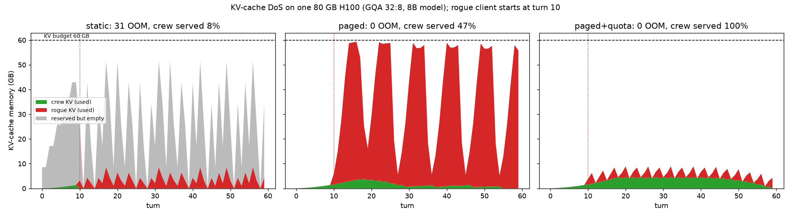

# Mission 03 — Part 4: Security & Ethics Sentinel
## FlashAttention IO Analysis & KV-Cache Denial-of-Service Audit

**Starship Operational Unit:** USSE Noosphere Bridge Crew
**Waypoint:** Pleiades Open Cluster (`SEC-03-M45`, 444 ly from Sol)
**Subsystem 03:** Distributed Multi-Head Attention Mesh & KV-Cache Transceiver
**Officer Name / Squadron:** Ahmed / Squadron Hinton

Supporting code (all numbers below come from these scripts and can be reproduced):

| Script | What it gives this audit |
|---|---|
| [`anomaly_03_sram_tiling.py`](anomaly_03_sram_tiling.py) | FlashAttention-2 forward in PyTorch with counted HBM reads/writes (§1.4) |
| [`03_GQA_and_KVCache_Benchmark.py`](03_GQA_and_KVCache_Benchmark.py) | KV-cache sizes, decode traffic and latency for MHA / GQA / MQA ([`03_benchmark_results.md`](03_benchmark_results.md)) |
| [`04_kv_cache_dos_simulation.py`](04_kv_cache_dos_simulation.py) | OOM capacity table and the 60-turn attack timeline (§2, [`04_dos_memory_timeline.png`](04_dos_memory_timeline.png)) |

---

### Section 1: FlashAttention IO Complexity Derivation

#### 1.1 Hardware Memory Hierarchy

The template's figures needed two corrections: on-chip SRAM is about 0.2 MB **per SM**, not 50 MB, and 19 TB/s is the A100 figure from the FlashAttention paper.

| Level | NVIDIA H100 SXM | NVIDIA A100 (FlashAttention paper) |
|---|---|---|
| SRAM (shared memory / L1, on chip) | up to 228 KB per SM × 132 SMs ≈ 30 MB | 192 KB per SM × 108 SMs ≈ 20 MB, ~19 TB/s |
| L2 cache | 50 MB | 40 MB |
| HBM (off chip) | 80 GB HBM3, 3.35 TB/s | 40/80 GB, 1.5–2.0 TB/s |
| Dense FP16/BF16 tensor compute | ~989 TFLOPS | 312 TFLOPS |

The H100's *ridge point* is 989 TFLOPS / 3.35 TB/s ≈ **295 FLOP per byte**. Any kernel that does fewer FLOPs per byte it moves to or from HBM is memory-bound. Softmax, masking and dropout do a handful of FLOPs per element, so a kernel that streams the $N \times N$ matrix through HBM is limited by bandwidth, not by the tensor cores.

#### 1.2 Standard Attention IO Complexity

Standard attention (Dao et al., 2022, Algorithm 0) for one head with $Q, K, V \in \mathbb{R}^{N \times d}$:

| Step | HBM reads | HBM writes |
|---|---|---|
| $S = QK^\top / \sqrt{d}$ | $Q, K$: $2Nd$ | $S$: $N^2$ |
| $P = \text{softmax}(S)$ (with mask) | $S$: $N^2$ | $P$: $N^2$ |
| $O = PV$ | $P, V$: $N^2 + Nd$ | $O$: $Nd$ |
| **Total** | | $4N^2 + 4Nd = \Theta(Nd + N^2)$ |

**Why $N^2$ saturates bandwidth beyond $N \approx 8192$.** Take one layer of an 8B model (32 heads, $d = 128$) at $N = 8192$ in FP16:

* One $N \times N$ matrix per head: $8192^2 \times 2\,\text{B} = 134\,\text{MB}$; for 32 heads, 4.3 GB.
* $S$ and $P$ cross HBM four times: $4 \times 4.3 = 17.2\,\text{GB}$ per layer, i.e. $17.2\,\text{GB} / 3.35\,\text{TB/s} \approx 5.1\,\text{ms}$.
* The useful matrix multiplies are $4N^2d$ FLOPs per head: $32 \times 4 \times 8192^2 \times 128 = 1.1\,\text{TFLOP}$, i.e. $\approx 1.1\,\text{ms}$ at 989 TFLOPS.

So the layer spends about **4.6× longer moving $S$ and $P$ than computing**. The $N^2$ term grows 4× every time the context doubles while the $Nd$ term grows only 2×, so the gap widens with context length. At 32k tokens a single layer's $S$ alone is 69 GB for 32 heads: it no longer fits in HBM at all. The quadratic term costs both bandwidth and capacity, and $N \approx 8$k is where it starts to dominate on current GPUs.

#### 1.3 FlashAttention SRAM Tiling Derivation

FlashAttention never writes $S$ or $P$ to HBM. It splits $Q$ into $T_r = \lceil N / B_r \rceil$ row blocks and $K, V$ into $T_c = \lceil N / B_c \rceil$ column blocks, small enough that a block of each, plus the score tile, fits in SRAM of size $M$:

$$B_c = \left\lceil \frac{M}{4d} \right\rceil, \qquad B_r = \min\left(\left\lceil \frac{M}{4d} \right\rceil, d\right)$$

**Online softmax.** Softmax needs the whole row, but the tile only shows $B_c$ columns at a time. For each query row FlashAttention keeps a running maximum $m$, a running denominator $\ell$, and an unnormalised output $\tilde{O}$. When the next tile $S^{(j)}$ arrives:

$$m^{\text{new}} = \max\left(m, \operatorname{rowmax}(S^{(j)})\right), \qquad \tilde{P}^{(j)} = \exp\left(S^{(j)} - m^{\text{new}}\right)$$

$$\ell^{\text{new}} = e^{m - m^{\text{new}}}\,\ell + \operatorname{rowsum}(\tilde{P}^{(j)}), \qquad \tilde{O}^{\text{new}} = e^{m - m^{\text{new}}}\,\tilde{O} + \tilde{P}^{(j)} V_j$$

After the last tile, $O = \tilde{O} / \ell$. The rescaling factor $e^{m - m^{\text{new}}}$ corrects everything accumulated under the old maximum, so the result is **exactly** softmax attention, not an approximation (our tiled implementation matches standard attention to $< 10^{-6}$).

**Counting HBM accesses (FlashAttention-1 loop order: outer loop over $K, V$ blocks).**

* $K$ and $V$ are each read once: $2Nd$.
* For each of the $T_c$ outer iterations, every $Q_i$, $O_i$, $\ell_i$, $m_i$ is read and $O_i$, $\ell_i$, $m_i$ written back: $\Theta(Nd)$ per iteration.

$$\text{IO}_{\text{Flash}} = \Theta\left(Nd + T_c \cdot Nd\right) = \Theta\left(\frac{N}{B_c} \cdot Nd\right) = \Theta\left(\frac{N^2 d}{M / 4d}\right) = \Theta\left(\frac{N^2 d^2}{M}\right)$$

FlashAttention-2 swaps the loops (outer over $Q$ blocks), so each $Q_i$ and $O_i$ crosses HBM once and $K, V$ are re-read $T_r$ times: $Nd + T_r \cdot 2Nd + Nd$, the same $\Theta(N^2 d^2 / M)$ bound with a better constant. Dao et al. also prove (Proposition 3) that no exact attention algorithm can do $o(N^2 d^2 / M)$ HBM accesses for all $M \in [d, Nd]$, so tiling is optimal up to constants.

**The reduction in HBM traffic.**

$$\frac{\text{IO}_{\text{Standard}}}{\text{IO}_{\text{Flash}}} \approx \frac{N^2}{N^2 d^2 / M} = \frac{M}{d^2}$$

With $d = 64$–$128$ and $M \approx 100$K elements, $d^2$ (4–16K) is many times smaller than $M$, so traffic drops several-fold; the paper reports up to 9× fewer HBM accesses on A100.

**What "from $O(N^2)$ to $O(N)$" really means.** The briefing's headline is about **memory footprint**, not traffic. FlashAttention stores only $O$ plus the per-row statistics $m, \ell$ (or the log-sum-exp $L = m + \log \ell$ for the backward pass): $O(N)$ extra memory instead of the $O(N^2)$ for $S$ and $P$. The **IO** is still quadratic in $N$, but divided by $M / d^2$. FlashAttention-3 (Shah et al., 2024) keeps this IO analysis and adds H100-specific overlap: asynchronous TMA loads, warp specialisation, overlapping softmax with the matmuls, and FP8. That brings it to 740 TFLOPS (75% of H100 peak) in FP16.

#### 1.4 Empirical check (side quest, `anomaly_03_sram_tiling.py`)

A FlashAttention-2 forward pass in PyTorch where every transfer between "HBM" and the "SRAM" block goes through a counter. $M = 100{,}000$ elements (~195 KB FP16), $d = 64$, so $B_r = B_c = 128$:

| N | Standard (MB, FP16) | Tiled (MB) | Tiled + causal block skipping (MB) | Reduction | Causal reduction |
|---:|---:|---:|---:|---:|---:|
| 1,024 | 8.9 | 2.4 | 1.4 | 3.8× | 6.2× |
| 4,096 | 136.3 | 34.6 | 18.4 | 3.9× | 7.4× |
| 16,384 | 2,155.9 | 541.1 | 274.8 | 4.0× | 7.8× |
| 65,536 | 34,393.3 | 8,606.8 | 4,320.3 | 4.0× | 8.0× |

The counted traffic equals the closed form exactly, and the outputs match standard attention to $< 10^{-6}$. The reduction tends to $2B/d$: doubling SRAM ($M = 200$K, $B = 256$) gives 7.9×. This meets the 3× side-quest target.

---

### Section 2: KV-Cache Denial-of-Service (DoS) Simulation

#### 2.1 Threat Scenario

FlashAttention fixes the attention *scratch* memory. It does nothing for the **KV-cache**, which must keep every past key and value for every live session. The cache grows linearly with context and with the number of concurrent sessions, and the client controls both.

$$\text{Bytes} = 2 \times 2 \times L \times H_{\text{KV}} \times d_{\text{head}} \times N \times B$$

(K and V) × (FP16 bytes) × layers × KV heads × head dim × tokens × sessions.

**Mainframe.** One 80 GB H100 serving a LLaMA-3-8B-shaped model ($L = 32$, $d_{\text{head}} = 128$, 32 query heads) in FP16. Weights take 16.06 GB and 4 GB is reserved for activations and the CUDA context, which leaves **59.94 GB** for KV.

**Adversary.** A rogue (or compromised) client on the crew comms channel. From turn 10 it opens 4 new sessions per turn, stuffs 8,192 tokens into every turn (pasted telemetry logs), never closes a session, and pushes each one to the maximum context $N = 65{,}536$. Each request is individually valid; only the aggregate is hostile. Legitimate crew traffic: 1 new session every 2 turns, 20 turns × 350 tokens each.

#### 2.2 Simulation Results

**Point of OOM: sessions at $N = 65{,}536$ that fit before the CUDA allocator fails.**

| Architecture | KiB / token | GB / session | Max sessions | OOM on session # |
|---|---:|---:|---:|---:|
| MHA 32:32 | 512.0 | 34.36 | 1 | 2 |
| GQA 32:8 (LLaMA 3) | 128.0 | 8.59 | 6 | 7 |
| MQA 32:1 | 16.0 | 1.07 | 55 | 56 |
| MLA, $d_c = 512$ + 64 RoPE dims | 36.0 | 2.42 | 24 | 25 |

With the standard architecture (GQA), **seven** max-length conversations exhaust an 80 GB accelerator; with plain MHA, **two** do. In general:

$$K_{\text{OOM}} = \left\lfloor \frac{\text{HBM} - \text{weights} - \text{reserve}}{4\, L\, H_{\text{KV}}\, d_{\text{head}}\, N} \right\rfloor + 1$$

**60-turn attack timeline (GQA 32:8)** — [`04_dos_memory_timeline.png`](04_dos_memory_timeline.png):

| Server policy | Attack | OOM panics | First OOM (turn) | Crew turns served | Crew sessions lost | Rejected requests | Peak reserved-but-empty |
|---|---|---:|---:|---:|---:|---:|---:|
| static preallocation | no | 3 | 12 | 30% | 18 | 0 | 49.9 GB |
| static preallocation | yes | 31 | 10 | 8% | 19 | 0 | 45.1 GB |
| PagedAttention | no | 0 | — | 100% | 0 | 0 | 9.4 MB |
| PagedAttention | yes | 0 | — | 47% | 12 | 0 | 8.1 MB |
| Paged + per-client quotas | no | 0 | — | 100% | 0 | 0 | 9.4 MB |
| Paged + per-client quotas | yes | 0 | — | **100%** | 0 | 198 | 9.4 MB |

What the runs show:

1. **The naive server panics without any attacker.** Reserving 65,536 tokens per session means only 6 sessions fit, so ordinary crew load causes the first CUDA OOM at turn 12. With the attacker, the panic comes at turn 10, the turn the attack starts, and repeats 31 times. Every OOM kills the whole batch: 19 crew conversations were lost mid-dialogue. Up to 50 GB of the 60 GB budget is reserved and empty.
2. **Paging removes the waste, not the attack.** With PagedAttention there are no panics and empty reservations fall to under 10 MB. But the attacker's tokens are *real* tokens: rogue sessions fill the full 60 GB within 4 turns, and the scheduler has to preempt sessions to make room. Crew turns served fall to 47%. The DoS has changed from a crash into starvation.
3. **Only admission control stops it.** With a quota of 2 concurrent sessions and 16,384 context tokens per client, the rogue client is capped at about 4 GB, 198 of its requests are refused, and the crew is served 100%.

Attack surface beyond memory: a 65k-token prompt also costs $\Theta(N^2)$ prefill compute (Section 1), so the same client can exhaust compute time even when memory is protected. Multi-turn dialogue makes this worse, because each turn re-sends the history unless the server caches the prefix.

---

### Section 3: Modern Architectural Mitigations

#### 3.1 PagedAttention (vLLM)

**How it works.** Kwon et al. (SOSP 2023) apply operating-system virtual memory to the KV-cache. Each sequence's cache is a list of fixed-size **blocks** (16 tokens by default) that need not be contiguous in HBM. A per-sequence **block table** maps logical blocks to physical blocks, like a page table, and the attention kernel follows the table.

**Internal fragmentation** (reserved but unused space inside an allocation) is removed because blocks are allocated on demand as the sequence grows, instead of reserving `max_len` up front. Waste is bounded by the partially filled last block: at most 15 tokens per sequence, i.e. 15 × 128 KiB ≈ 1.9 MB for our model, versus the 49.9 GB of empty reservations in the static run. The vLLM paper measured 60–80% of KV memory wasted in earlier systems, against under 4% with paging.

**External fragmentation** (free memory split into holes too small for the next contiguous allocation) disappears because every block is the same size: any free block can serve any sequence, so all free memory is usable.

**Further benefits.** Copy-on-write block sharing: a shared system prompt or parallel samples of the same prompt store their common prefix once. Preemption: when memory runs out, whole sequences are swapped to CPU or recomputed later instead of crashing.

**Limits as a security control.** Paging makes the server efficient and crash-free, but it allocates for whoever asks. Our run shows a single client can still take 100% of KV memory. Paging is a *precondition* for fair-share control (blocks make per-tenant budgets cheap to enforce); it is not the control itself.

#### 3.2 Multi-Head Latent Attention (MLA / DeepSeek-V2 and V3)

**How it works.** Instead of caching per-head keys and values, MLA caches one low-rank latent vector per token:

$$c_t^{\text{KV}} = W^{\text{DKV}} h_t \in \mathbb{R}^{d_c}, \qquad k_t^{C} = W^{\text{UK}} c_t^{\text{KV}}, \qquad v_t^{C} = W^{\text{UV}} c_t^{\text{KV}}$$

with $d_c \ll n_h d_h$. At inference the up-projections are absorbed into the neighbouring matrices ($W^{\text{UK}}$ into $W^Q$, $W^{\text{UV}}$ into $W^O$), so attention runs directly on the cached latents and the full keys and values are never materialised. RoPE does not commute with that absorption, because the rotation depends on position. MLA therefore adds a small **decoupled RoPE key** $k_t^R \in \mathbb{R}^{d_h^R}$ shared by all heads, and caches it next to $c_t^{\text{KV}}$. DeepSeek-V3: $d_c = 512$, $d_h^R = 64$, 128 heads of $d_h = 128$, 61 layers.

**Comparison table: KV-cache per token.**

| Mechanism | Elements per token per layer | Formula | 8B shape, 32 layers, FP16 | DeepSeek-V3 shape (128 heads, 61 layers) |
|---|---:|---|---:|---:|
| MHA | 8,192 | $2 n_h d_h$ | 512 KiB | 32,768 el. → 3.8 MiB |
| GQA (8 groups) | 2,048 | $2 n_g d_h$ | 128 KiB | — |
| MQA | 256 | $2 d_h$ | 16 KiB | — |
| **MLA** | **576** | $d_c + d_h^R$ | **36 KiB** | **576 el. → 68.6 KiB (−98.2% vs MHA)** |

DeepSeek reports a 93.3% KV reduction for V2 against their earlier dense 67B model; against an MHA model of the same shape the saving is 98%. MLA sits between GQA and MQA in size, but DeepSeek-V2's ablations show it **matching or beating MHA in quality**, which MQA and GQA do not.

**As a DoS defence.** In our scenario MLA raises the OOM point from 7 to 25 max-length sessions (3.6× over GQA). This raises the cost of an attack in proportion, but an attacker who opens 3.6× more sessions gets the same result. Costs: an architectural change that needs (re)training or conversion (e.g. MHA2MLA, TransMLA), and the extra up-projection compute in prefill.

#### 3.3 Recommended defence for Subsystem 03

Layered, cheapest first:

1. **Admission control (stops the attack):** authenticate clients; per-client limits on concurrent sessions, context length and total KV blocks; token-rate limits; refuse with a clear error instead of crashing. In our run this was the only policy that kept the crew at 100%.
2. **PagedAttention (stops self-inflicted OOM):** on-demand blocks, preemption by swap or recompute, prefix sharing for the common system prompt. Removes the crash and the 50 GB of waste.
3. **Smaller cache per token (raises the bar):** GQA today; MLA or KV quantisation (FP8 or INT4 KV) for future models. Every 2× saving doubles the attacker's required effort.
4. **Fair scheduling and monitoring:** priority for safety-critical bridge traffic (astrogation over chat), per-tenant memory dashboards, alerts when one client holds more than X% of blocks, idle-session eviction.

**Ethics note.** Availability is a safety property: if a crew member's emergency query is starved because another client filled the cache, the system has failed as surely as if it had answered wrongly. Quotas must still be fair. A long-context limit that protects the ship should not silently truncate a legitimate user's history; refusals should be explicit and logged, and safety-critical roles should get reserved capacity instead of competing with everyone else.

---

### References

* Dao, Fu, Ermon, Rudra, Ré (2022). *FlashAttention: Fast and Memory-Efficient Exact Attention with IO-Awareness.* NeurIPS. arXiv:2205.14135
* Dao (2023). *FlashAttention-2: Faster Attention with Better Parallelism and Work Partitioning.* arXiv:2307.08691
* Shah, Bikshandi, Zhang, Thakkar, Ramani, Dao (2024). *FlashAttention-3.* arXiv:2407.08608
* Kwon et al. (2023). *Efficient Memory Management for Large Language Model Serving with PagedAttention.* SOSP. arXiv:2309.06180
* DeepSeek-AI (2024). *DeepSeek-V2.* arXiv:2405.04434; *DeepSeek-V3 Technical Report.* arXiv:2412.19437
* Ainslie et al. (2023). *GQA: Training Generalized Multi-Query Transformer Models from Multi-Head Checkpoints.* arXiv:2305.13245

---

### Squadron Sign-Off
- [ ] Systems Architect: Mohid
- [ ] Communications Officer: Sharjeel
- [ ] Data Specialist: Shayan
- [ ] Security Sentinel: Ahmed
